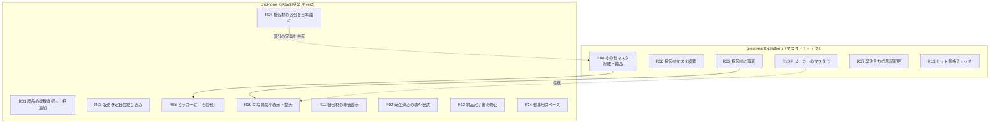

# 店舗別受発注v2とマスタの改善（2026-10要望）

> [[PRJ-06-直営店・FC店受発注の自社システム化によるインフォマートコスト削減|PRJ-06]] で作った店舗別受発注 ver2（[[choi-tone]]）と、その元データである [[green-earth-platform]] の梱包材マスタ等に対する、**2026-10-15 時点の改善要望 14 件**（要望14・15 の新スペース系を含む）の実装計画。レジデータ（要望15）は規模が別なので [[PRJ-11-レジデータ（SJL）取込]] に分けた。

> [!note] このノートの位置づけ
> 実装前の**計画**。コードは `~/git/02_green-earth/choi_tone` と `~/git/02_green-earth/green-earth-platform` を 2026-10-15 に読んで書いている（「現状」列）。着手したら状態を更新し、決まったことは「決定ログ」へ。タスクの進捗そのものは reqnavi が正（[[00 MOC]] の運用ルール）。

## 0. 要望の番号について

元の要望リストで **「要望10」が 2 つある**（platform 側＝梱包材メーカーのマスタ化／choi-tone 側＝写真の小表示・拡大）。ここでは区別のため **10-P**（platform）・**10-C**（choi-tone）と書く。

## 1. 全体像

**依存はほぼ「platform のマスタ → choi-tone の表示」の一方向。** choi-tone は platform の `public` スキーマを**読み取り専用**で読む（[[choi-tone]] の方針、`store-order-master-data.ts` の冒頭コメント）ので、マスタ側の変更が先、ピッカーへの反映が後になる。

## 2. 要望ごとの計画

規模は S（半日以内）／M（1〜2日）／L（3日〜）の目安。

### green-earth-platform

| # | 要望 | 現状（コードで確認） | 変更方針 | 規模 |
|---|---|---|---|---|
| R06 | **その他マスタ（制服・備品）** | 梱包材は `packaging_materials` テーブル＋`master/packaging/` の一覧・フォーム。区分は `bag/box/seal/label_seal` | 梱包材マスタと同じ画面・項目で「制服」「備品」を管理できるようにする。**方式は要決定（§4-①）**。推奨は別テーブル `other_supplies`（区分: 制服／備品）で、`PackagingForm` 等を共通化 | M〜L |
| R07 | **発注入力の表記変更** | `check/order-input/OrderInputView.tsx`。「卸単価」「単価」の見出し | 「卸単価」→「**卸単価（税込）**」、「単価」→「**単価（税抜）**」。ラベル変更のみだが、**表示値が本当に税込／税抜かを計算側で確認**してから変える（§4-⑤） | S |
| R08 | **梱包材マスタに検索欄** | `master/packaging/page.tsx` は一覧のみ | 品名・取引先名・メーカー・区分で絞り込める検索欄（クライアント側フィルタで十分。件数が少ない前提） | S |
| R09 | **梱包材マスタに写真** | `product_info` には写真の仕組みがある（migration `20260623020001_product_info_stores_array_and_photo.sql`）。梱包材には無い | `packaging_materials` に写真列を追加。保存先・アップロードは商品の写真と**同じ仕組みに揃える**（実装を読んでから決める）。フォームに画像選択とプレビュー | M |
| R10-P | **メーカーをマスタ化して選択式に** | 現状 `PackagingForm` の「メーカー（取引先）」は**自由入力の文字列**（`supplier`） | `packaging_suppliers`（メーカーマスタ）を新設し、`packaging_materials.supplier_id` で参照。**既存の `supplier` 文字列の異なる値から初期データを作って移行**する。マスタ管理画面（追加・改名・無効化）も要る | M |
| R13 | **セット価格チェック** | `check/` 配下は `item-master / labor-cost / order-input / packaging`。セット用のチェックは無い | 新ページ `check/set-price`。セットごとに **A＝構成商品の単体価格の合計 ／ B＝梱包材の価格の合計 ／ C＝セットに登録した販売価格** を並べた**一覧**、行を押すと**サイドピーク**で内訳。**間違いがあれば販売価格をその場で修正**できる。A+B と C の差が大きい行を目立たせる。**「単体価格」の定義は要確認（§4-⑥）** | L |

### choi-tone（店舗別受発注 ver2）

| #     | 要望                 | 現状（コードで確認）                                                                                                            | 変更方針                                                                                                                                                                                              | 規模         |
| ----- | ------------------ | --------------------------------------------------------------------------------------------------------------------- | ------------------------------------------------------------------------------------------------------------------------------------------------------------------------------------------------- | ---------- |
| R01   | **商品の複数選択→一括追加**   | `StoreOrderProductPickerV2.tsx`。1つ選ぶとすぐ追加される                                                                          | 選択を**一時リスト（カート）に積み**、ピッカー下部に「追加する商品」リストを出し、**「追加」ボタンで一括反映**。リストから外す・数量指定の扱いを決める（§4-⑦）。`orderBlockedReason`（ケース入数・卸価格が未登録）の商品は従来どおり選択を止める                                                          | M          |
| R03   | **販売予定日による非表示**    | `store-order-master-data.ts` は `items` を `final/set` で全件読む。`product_info.launch_date` / `launch_date_end` は**読んでいない** | `product_info` から両列を読み、**「販売予定日が入っていて、かつ終了日が今日以降」の商品を候補から除く**。梱包材には日付が無いので対象外。**解釈が文字どおりでよいか要確認（§4-②）**                                                                                           | S          |
| R04   | **梱包材の区分を日本語に**    | 梱包材の `category` に DB の生の値（`bag` 等）をそのまま入れているため、ピッカーに英語が出る。platform 側の表示名は `PACKAGING_CATEGORY_LABELS`（袋・箱・シール・ラベルシール） | choi-tone 側に**同じ対応表**を持ち、`category` を日本語に変換して渡す。**表は 2 リポジトリに重複するので、R06 で区分が増えるときは両方更新**（コメントで相互参照を残す）                                                                                            | S          |
| R05   | **ピッカーに「その他」**     | ピッカーは「最終商品／セット商品／梱包材」の 3 タブ（`STORE_ORDER_ITEM_TYPE_LABEL`）                                                            | R06 のマスタを読み込み、`itemType` に「その他」を追加、タブを 4 つに。梱包材と同様の発注単位・卸価格で `orderBlockedReason` を判定                                                                                                             | M（R06 後）   |
| R10-C | **写真の小表示・拡大**      | 梱包材の写真は無い（R09 待ち）                                                                                                     | ピッカーの梱包材行にサムネイル、**押すとモーダルで拡大**。ローダーで写真の URL も読む                                                                                                                                                   | S〜M（R09 後） |
| R11   | **梱包材の単価表示**       | 発注単位を `packQuantity` に入れ、`unit` は `"単位"`（`PACKAGING_UNIT_LABEL`）固定。グリッドが「5/単位」と表示                                     | 表示を「**数字 + 単位名 / セット**」に（例：オリジナル保冷バッグ → **5個/セット**）。単位名は platform の `unit_label`（個・枚）を使う。**`"単位"` はグリッドが商品の「ケース」と見分ける目印にも使っている**ので、表示だけ変えるか目印ごと変えるかを実装時に決める。**保存済みの発注行は `unit="単位"` のまま**残る点に注意   | S〜M        |
| R02   | **発注済みの横長・A4印刷出力** | 納品・発注済みの集計は `store-order-report*.ts`（`store_order_report_v2` アプリ）に既にある。現状の出力は縦で、チェック欄が 2 つ                            | **`store_order_report_v2` と同じ出力形式**を、店舗別受発注 ver2 の「発注済み」から出せるようにする。**A4 横向き**（`@page { size: A4 landscape }`）にして横幅を広く使い、**チェック欄は 1 つ**にする。既存レポートの出力コンポーネントをパラメータ化して流用（コピーしない）。**出力の単位は要確認（§4-③）** | M          |
| R12   | **納品完了後の修正**       | レコードに `deliveredAt`（納品完了）があり、完了後は確定数量・納品数量が固定される                                                                      | 納品完了後でも**権限のある人は修正できる**ようにする。選択肢は「完了を取り消して再編集」か「完了後修正モード」。**修正履歴（誰が・いつ・何を）を残す**。レポート集計（`store-order-report-data.ts`）に影響するので修正後に再計算される前提を確認                                                        | M〜L        |
| R14   | **催事用スペースの追加**     | スペース／アプリは DB のレコード。ver2 を専用スペースへ移した migration（`20260910020000_move_store_order_v2_to_own_space.sql`）が先例               | 「**催事（イベント）ごとにアプリを作って管理**」できるようにする。アプリが**かなり増える前提**なので、migration を手で書き足す方式は避け、**ver2 をテンプレートに画面からアプリを複製して作れる**仕組みを検討。方式は要決定（§4-④）                                                                 | L          |

## 3. 進め方（推奨順）

小さくて他に依存しないものを先に出し、依存のある表示系を後にする。

| 順 | まとまり | 含む要望 | 理由 |
|---|---|---|---|
| 1 | **すぐ直せる表記・表示** | R07, R04, R03, R08 | 規模 S。独立していて、現場の混乱（英語表示・出てほしくない商品）がすぐ減る |
| 2 | **梱包材マスタの拡充（platform）** | R10-P, R09, R06 | R06・R09 は choi-tone 側の R05・R10-C の前提。**マイグレーションはまとめて 1 回で流す方が安全**（列追加・新テーブル・移行が絡むため） |
| 3 | **ピッカーの改善（choi-tone）** | R01, R11, R05, R10-C | ピッカー周辺なので同じコンポーネント（`StoreOrderProductPickerV2` / `StoreOrderItemsGrid`）を触る。まとめて回帰確認する |
| 4 | **出力と修正** | R02, R12 | 帳票とレコード状態遷移。R02 は先方の印刷サンプルを見ながら |
| 5 | **セット価格チェック** | R13 | 他と独立。1・2 と並行できる。定義の確認（§4-⑥）が済んでから |
| 6 | **催事スペース** | R14 | 方式の決定（§4-④）が要る。決まるまで他を止めない |
| 別 | **レジデータ** | （R15） | [[PRJ-11-レジデータ（SJL）取込]] として独立。1〜6 と並行可 |

> [!tip] 並行できる単位
> **platform 側（順2・5）と choi-tone 側（順3・4）は別リポジトリなので並行で進められる。** ただし同じリポジトリ内の作業同士は同じファイルを触りやすい（特に順3）ので 1 本ずつ。

## 4. 要確認・要決定

先方（[[高波さん]]・[[山中さん]]）に聞くことと、こちらで決めることが混ざっている。**← 番号の後の矢印が確認先。**

1. **その他マスタの作り方**（こちらで決める）— 別テーブル `other_supplies` か、`packaging_materials` に種別列を足すか。梱包材の区分（袋・箱…）と「制服・備品」は性質が違うので**別テーブルを推奨**。ただし項目（発注単位・卸価格・写真）はほぼ同じなので画面は共通化する。
2. **R03 の条件の解釈**（先方に確認）— 文面は「販売予定日が入力されていて、かつ日付の終わりが今日以降のものは表示しない」。**文字どおりだと「期間の終了日が未来のもの＝まだ販売期間中のもの」が消える**ことになり、意図（〔まだ発売前の商品を出さない〕か、〔販売終了後の商品を出さない〕か）と逆かもしれない。実装前に「発売前は隠す」「期間が終わったら隠す」のどちらかを確認する。
3. **R02 の出力単位**（先方に確認）— 店舗ごとに 1 枚か、全店舗をまとめた表か、納品日ごとか。`store_order_report_v2` の現行出力のどこを「同じ」にするのか（列構成・グルーピング）も印刷サンプルで確認。
4. **R14 の方式**（こちらで決める）— (a) 催事用の**1 つのスペースにイベントごとのアプリ**を置く、(b) イベントごとにスペースを作る。要望の文面は (a)。アプリ作成を画面から行えるか、管理者が migration で作るかも含めて決める。
5. **R07 の税込・税抜**（こちらで確認）— 「単価の部分は税抜のはず」とのこと。`check/order-input` の計算で実際にどう持っているかを読んでから表記を変える。
6. **R13 の「単体価格」**（先方に確認）— 構成商品の単体価格は**販売価格（税抜？税込？）か、卸価格か**。セット側の販売価格との**税の扱い**を揃えないと比較にならない。梱包材の価格は単価か卸価格か。
7. **R01 の一括追加の細部**（こちらで決める）— 一時リストの中で数量まで入れさせるか、追加後にグリッドで入れるか。同じ商品を二度選んだ場合は無視か加算か。
8. **R12 の権限と履歴**（先方に確認）— 納品完了後に直せるのは誰か（店舗か本部か）。直した事実を集計や帳票に表示するか。

## 5. 作業の注意

- **両リポジトリとも、変更したら Vault 側のこのノートと [[choi-tone]] / [[green-earth-platform]] を更新する**（[[README]] の「関連リポジトリ」と各 `CLAUDE.md` のルール）。
- マイグレーションは 2 リポジトリで別系統。**choi-tone が読む `public` スキーマの列名を変えない**（読み取り側が壊れる）。列を足すのは安全。
- 区分の表示名（R04）、発注単位の表示（R11）のように **「2 つのリポジトリが同じ言葉を持つ」箇所が増える**。これは [[choi-tone]] の「マスタの重複」の論点と同じ構造なので、将来の整理候補として覚えておく。

## 関連

- 親案件: [[PRJ-06-直営店・FC店受発注の自社システム化によるインフォマートコスト削減]]
- 分割した案件: [[PRJ-11-レジデータ（SJL）取込]]（要望15）
- 前提: [[PRJ-01-商品マスタ構築]]（梱包材・セットのマスタ）／[[PRJ-09-プライスカード自動生成・確認フロー改善]]（商品情報の価格まわり）
- プラットフォーム: [[choi-tone]] ／ [[green-earth-platform]]
- 人物: [[高波さん]] ／ [[山中さん]]
- 未確定事項: [[_未確定事項]] の「E. 2026-10 要望」
