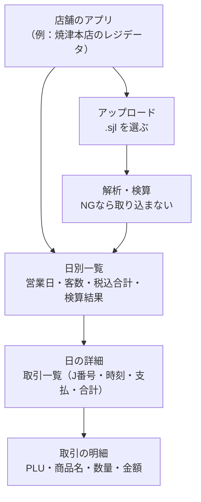

# レジデータ（SJL）取込

> 店舗レジが 1 営業日ごとに出力する電子ジャーナル（`.sjl`）をアップロードすると、**日別の売上レコード**として登録され、押すと**取引・明細の詳細**が見られるようにする。2026-10-15 の要望15。

> [!success] 2026-10-15 実装完了（main にマージ済み・画面の動作確認はこれから）
> PR: [choi_tone#23](https://github.com/green-earth-platform/choi_tone/pull/23)。結果は末尾の「## 実装結果」。先方向けは [[2026-10-15 リリースノート（先方送付用）]]。

> [!note] 以下は実装前の計画（§4 の「まだ動かしていない」も当時の記述。パーサは実装後にテスト済み）
> 解析の仕様は [[レジ電子ジャーナル解析仕様]]（先方レジの仕様なので `40-ツール/`）、試作パーサは `parse_ej.py`（現在は `~/Downloads/`。**リポジトリに入れていない**）。[[PRJ-08-実績のDB化]]（売上実績の DB 化）の「日々の売上をレジから直接取り込む」側にあたる。

## 1. やりたいこと（要望15の文面）

- 新しいスペースに「**レジデータ**」というアプリを作る
- アプリは**店舗ごと**にある
- `.sjl` を UPLOAD すると、そのデータを登録する
- 基本は UPLOAD すると**日別にレコードができる**。押すと中身の詳細が見える
- 仕様書を添付（→ [[レジ電子ジャーナル解析仕様]]）

## 2. 画面イメージ

## 3. 解析仕様の要点（詳細は [[レジ電子ジャーナル解析仕様]]）

- 1 ファイル＝1 営業日。**cp932 でデコードしてから**行を解析する（バイト列のまま `\` を探すと壊れる）。`.euc` は使わず `.sjl` を正とする
- ヘッダ行で区切り、**種別コード 1（売上）・2（訓練）**を取引に、**8（店舗精算）**を検算用レポートとして保持
- 状態は 通常／取消／訓練／釣準備。**売上集計は「通常」だけ**
- **J番号でソートし、`(business_date, j_no)` をキーに upsert**（再取込で重複させない）
- 取り込みのたびに、同日最後の「店舗日計レポート」と**検算**する。NG ならロールバックして差分を報告
- 2024-08-01 の検証値（税込合計 122,953／客数 34 など）が [[レジ電子ジャーナル解析仕様]] §5 にあり、**パーサの合格基準**にできる

## 4. 試作パーサ `parse_ej.py` と仕様書の差

試作は仕様の大半をなぞっている（デコード順、ヘッダ判定、明細・数量・売価変更・小計割引・外税・合計・支払の抽出、状態判定）。**まだ動かしていない（読んだだけ）**。本実装前に埋める差:

| 項目 | 仕様書 | `parse_ej.py` |
|---|---|---|
| 出力 | DB（receipts / receipt_items / ingest_log） | CSV 3 本（receipts / items / reports.txt） |
| 検算 | 必須（種別8のレポートと照合） | **無し**（合計を印字するだけ） |
| 種別8レポートの解析 | 検算のため項目を取り出す | **本文を文字列で保存するだけ** |
| 再取込 | `(business_date, j_no)` で upsert | 無し（毎回 CSV を上書き） |
| 明細の行番号 | `line_no`（取引内 1 始まり） | 無し（J番号で並べるのみ） |
| 支払方法 | 併用の可能性があるので**配列**で持つのが安全 | `"現金/クレジット"` の文字列連結 |
| 領収書（種別61） | 任意 | 読み飛ばし |
| 取込元ファイル名 | `source_file` | 無し |
| 実行環境 | Web アプリから呼ぶ | Python のコマンドライン |

> [!warning] 実行環境の違い
> choi-tone は Next.js（Vercel 上）。Python のスクリプトはそのまま載らない。**TypeScript に移植して Server Action / Route Handler で解析する**のが素直（正規表現は流用できる）。移植するなら、Python 版と TS 版を**同じサンプルで突き合わせて**一致を確認する。

## 5. データの持ち方（案）

仕様書 §4 のテーブルをそのまま使う。

| テーブル | 1行 | 備考 |
|---|---|---|
| `receipts` | 1 取引 | `(store, business_date, j_no)` で一意。**店舗列を足す**（仕様書は 1 店舗のファイル前提） |
| `receipt_items` | 1 明細 | `line_no`・`plu`（**文字列**で先頭ゼロ保持）ほか |
| `ingest_log` | 1 取込 | ファイル名・取込日時・件数・検算結果と差額 |

**置き場所の推奨: choi-tone 側のスキーマ。** [[choi-tone]] は「入力の窓口」で、`public`（[[green-earth-platform]]）は読み取り専用という約束がある。取り込んだデータを [[PRJ-04-経営用ダッシュボード]] などで使うときは platform から読む。platform 側（`public`）に置く案もあり、どちらにするかは **§6-① で決める**。

## 6. 要確認・要決定

1. **データの置き場所**（こちらで決める）— choi-tone のスキーマか、platform の `public` か。上記の推奨は choi-tone。ダッシュボードで使う前提なら platform から読める形にしておく。
2. **店舗の特定**（先方に確認）— ファイルに店舗名が入っているか。ヘッダ 5 列目は「店舗／レジ番号の可能性」（仕様書では不明）。**アプリが店舗ごとなので、アップロード先のアプリで店舗を決める**運用で足りるが、**別店舗のファイルを誤ってアップロードした**ときの検知手段（ファイル内の店舗表記と突き合わせる等）を決める。
3. **レジの台数**（先方に確認）— 1 店舗に複数レジがあると、ファイルが 1 営業日 1 本にならない。J番号が日をまたいで通番なので重複の扱いも変わる。
4. **ファイルのサイズと一括アップロード**（こちらで確認）— 1 日分のサイズ。Vercel のリクエストサイズ制限（Server Action / Route Handler）に収まるか、**複数日をまとめて**アップロードしたいか。
5. **上書きの扱い**（先方に確認）— 同じ日を再アップロードしたとき、上書きでよいか、差分を見せるか。検算 NG のとき取り込みを止めてよいか（仕様書は止める）。
6. **過去データ**（先方に確認）— レジに残っている過去分を遡って取り込むか。[[PRJ-08-実績のDB化]] の Excel 396 ファイル（ISS-33）との**二重管理**にならないよう、どちらを正とするか（ISS-37 と同じ論点）。
7. **誰が見るか**（先方に確認）— 店舗スタッフか本部か。権限はアプリ単位でよいか。
8. **PLU と商品マスタの突き合わせ**（こちらで決める）— 仕様書は「商品名は切れるので **PLU で識別して商品マスタから引く**」。PLU が [[green-earth-platform]] の商品マスタ（`sku` 等）のどれに対応するかを確認する。対応が無いと明細は PLU と切れた名前しか出せない。

## 7. 進め方（案）

| 順 | 内容 | 完了の目安 |
|---|---|---|
| 1 | §6 の確認、サンプル `.sjl` の入手（検証値付きの 1 日分） | 置き場所・店舗特定・レジ台数が決まる |
| 2 | TS パーサ＋検算（アプリには載せず単体で） | 2024-08-01 の検証値と全項目一致 |
| 3 | 新スペース「レジデータ」と店舗アプリの雛形（[[PRJ-10-店舗別受発注v2とマスタの改善（2026-10要望）\|PRJ-10]] の R14 と同じ「アプリを増やす仕組み」を使えるか確認） | 1 店舗で日別一覧・詳細が出る |
| 4 | 全店舗へ展開、再取込・検算 NG の運用確認 | 先方が日次で取り込める |

**R14（催事用スペース）と、アプリを店舗ごとに増やす仕組みを共有できる可能性がある。** どちらもスペースの下にアプリが増えていく構造なので、先に作る方で仕組みを決める。

## 関連

- 仕様: [[レジ電子ジャーナル解析仕様]]
- 同時に出た要望: [[PRJ-10-店舗別受発注v2とマスタの改善（2026-10要望）]]
- 関連案件: [[PRJ-08-実績のDB化]]（売上実績の DB 化）／[[PRJ-04-経営用ダッシュボード]]（売上の行き先）
- プラットフォーム: [[choi-tone]] ／ [[green-earth-platform]]
- 未確定事項: [[_未確定事項]] の「E. 2026-10 要望」

## 実装結果

### 作ったもの

- **パーサ（TS）**: 試作 `parse_ej.py` を TypeScript に移植。`line_no`・支払の配列・訂正系（画面訂正／直前訂正／通番訂正／訂正モード）の扱いを補い、同日の店舗日計レポート（種別8）との**検算**を実装。**2024-08 の 31日分すべてでレポートと一致**することをテスト（`npm test`）で確認した。`parse_ej.py` 自体は引き続き `~/Downloads/` にあり、リポジトリには入れていない
- **DB**: `20261020010000_add_register_data.sql`（ユーザーが SQL Editor で手動実行）。`apps.is_register_data` 列、`register_days`（日別・検算結果）／`register_receipts`（取引。`(app_id, business_date, j_no)` で一意）／`register_receipt_items`（明細。PLU は文字列）／`register_ingest_log`（取込ログ。検算NGで取り込まなかった記録も残す）。支払は `payments`（jsonb の配列）にまとめた
- **スペース・アプリ**: 新スペース「レジデータ」（`d89ca692-5f7b-4f6b-aa66-46f1e1f08167`）に、**店舗マスタ分の店舗アプリ**を作成（作り方は受発注・棚卸と同じ。`apps.store_id`＋同じ slug）。権限グループも設定
- **画面**: 日別一覧（営業日・客数・税込合計・検算結果）→ 日の詳細（取引一覧）→ 取引の明細。**複数日をまとめて選べるアップロード**、検算NGは取り込まず差分を表示、別店舗の疑いがあるファイルは取込前に確認、再アップロードは `(店舗, 営業日, J番号)` で上書き

### §6 の決着

| § | 内容 | 決着 |
|---|---|---|
| 1 | データの置き場所 | choi-tone のスキーマ（`choi_tone`）。platform から読む形は未着手 |
| 2 | 店舗の特定 | **アップロードする人が自分の店舗のアプリを選ぶ**（ユーザー決定）。誤アップロードは、疑いがあるときに確認を挟む |
| 3 | レジの台数 | 〔未確認〕1店舗に複数台あるかは先方に未確認 |
| 4 | サイズ・一括 | 複数日の一括アップロードに対応。Vercel のリクエストサイズ制限は〔実機で未確認〕 |
| 5 | 上書き | 上書き（upsert）。検算NGは取り込まない |
| 6 | 過去データ | 〔未確認〕遡って取り込むか、実績 Excel（[[PRJ-08-実績のDB化]] の ISS-33/37）との正の決め方は未決 |
| 7 | 誰が見るか | アプリ（店舗）単位の権限。細かい権限は未検討 |
| 8 | PLU と商品マスタ | 〔未着手〕明細は PLU と（切れた）商品名のまま。商品マスタとの突き合わせは次の段階 |

### 残っていること

- [ ] 画面での動作確認（`20240801.sjl` で検算OK・税込合計 122,953・客数 34）と、**確認で取り込んだテストデータの扱い**
- [ ] レジの台数／過去データの取込方針／実績 Excel との二重管理（先方）
- [ ] PLU と商品マスタの突き合わせ（[[PRJ-04-経営用ダッシュボード]] へつなぐとき）
- [ ] 実際の大きさのファイルで Vercel のサイズ制限に当たらないか

