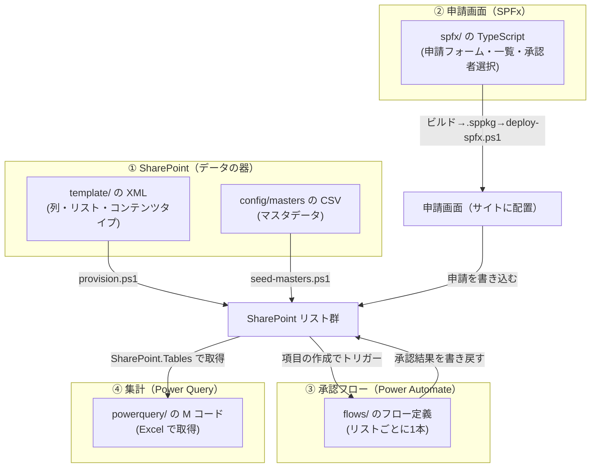
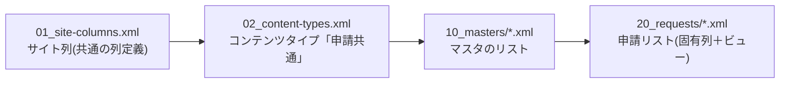
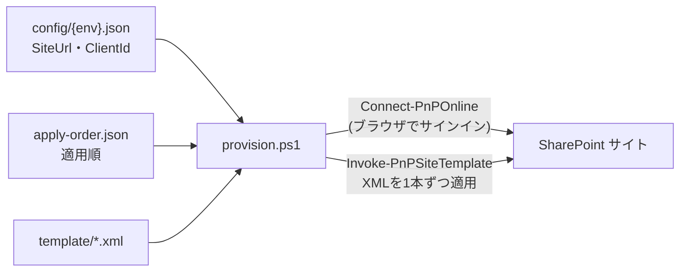
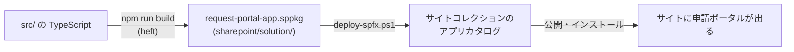
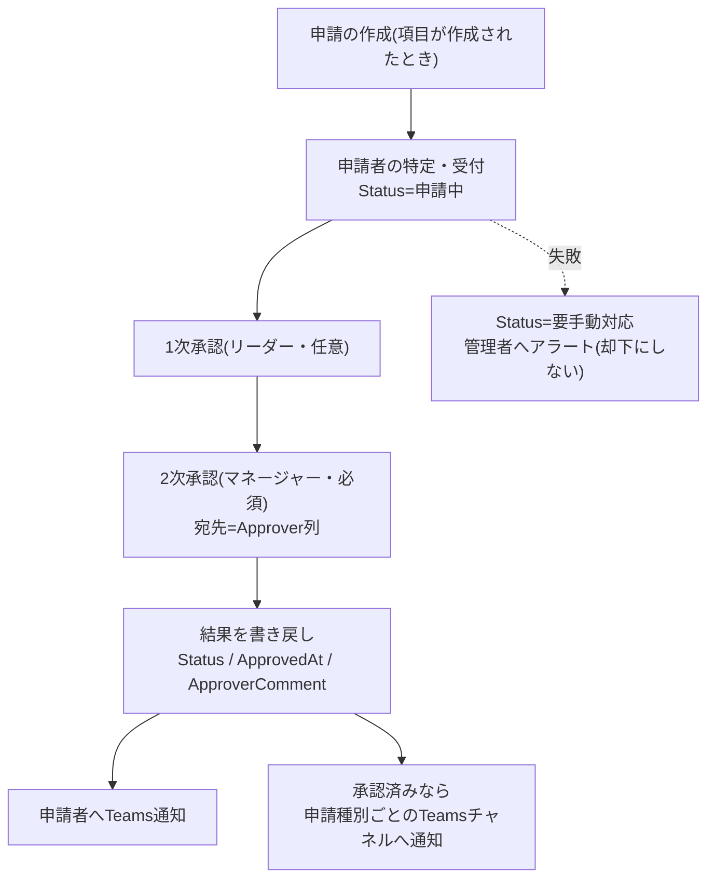
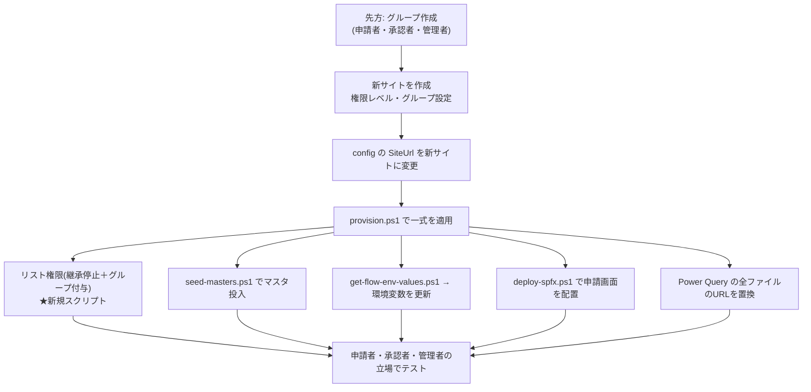

---
tags:
  - ケーテック
  - プラットフォーム
  - リポジトリ
  - GitHub
  - デプロイ
client: ケーテック株式会社
created: 2026-11-27
updated: 2026-11-27
---

# リポジトリ構成とデプロイの仕組み（XML・SPFx・フロー・Power Query）

親: [[00 MOC|ケーテック株式会社 MOC]] ／ 関連: [[2026-12-30 打ち合わせ]]（サイト作り替え）

> [!info] このノートの役割
> 「申請ポータル」を **GitHub のリポジトリで管理して、テナントに反映する仕組み**の全体像をまとめた復習用ノート。
> XML・PowerShell（pwsh）・SPFx・Power Automate・Power Query が**どう繋がっているか**、変更したときに**どこを直すか**を一枚で追えるようにする。
> リポジトリ: `k-ktec/k-tec_spo_simple`（GitHub。ブランチは現在 `main` のみ）

---

## 1. 一番大事な考え方

> [!important] 正はリポジトリ。テナントは「適用した結果」にすぎない
> - 画面（GUI）で直接手を入れて済ませない。**直したいときはリポジトリのファイルを直して、それをテナントへ適用する**。
> - こうしておくと、テナントを作り直しても（今回の12/30のサイト作り替えのように）**同じ内容を再現できる**。
> - 例外は「画面で作ってから吸い出す」場合だけ。吸い出したら必ずリポジトリへ戻す。


---

## 2. 全体像：4つの層とつなぎ目

申請ポータルは**4つの部品**でできていて、それぞれ作り方・置き場所・反映方法が違う。



| 層 | 何を作るか | リポジトリの場所 | テナントへの反映方法 | サイトURLの持ち方 |
|---|---|---|---|---|
| ① SharePoint | リスト・列・マスタ | `template/`（XML）、`config/masters/`（CSV） | `provision.ps1` / `seed-masters.ps1`（pwsh） | 持たない（接続先は `config/` のみ） |
| ② SPFx | 申請画面（Web パーツ） | `spfx/request-portal-app/` | ビルド → `.sppkg` → `deploy-spfx.ps1` | **持たない**（開いているサイトから自動取得） |
| ③ Power Automate | 承認フロー | `flows/` | ソリューション zip をインポート | **環境変数**（サイトURL＋リストGUID） |
| ④ Power Query | Excel 用の取得クエリ | `powerquery/` | Excel に貼り付け／配布ファイル | **各ファイルに直書き** |

> [!tip] 「サイトを作り替える」とき、直す場所が違う理由
> SPFx はサイトURLを持たない（開いたサイトに合わせて動く）ので**デプロイし直すだけ**。
> フローは**環境変数の値だけ**差し替え。Power Query だけは**全ファイルの URL を書き換える**。
> → 詳しくは § 9 の「変更パターン」。

---

## 3. リポジトリの構成

```
k-tec_spo_simple/
├─ CLAUDE.md              作業ルール(必読)。設計判断・落とし穴が全部入っている
├─ README.md
├─ template/              ① SharePoint の設計図(XML)
│   ├─ 00_common/           全リスト共通の「サイト列」と「コンテンツタイプ」
│   ├─ 10_masters/          マスタ(慶弔・メニュー・営業日カレンダー・従業員)
│   ├─ 20_requests/         申請リスト(番号=課題No)。_pending/ は保留・取り下げ分
│   └─ apply-order.json     適用順と、有効/無効(enabled)の一覧。唯一の正
├─ scripts/               pwsh(PowerShell 7)のスクリプト
│   ├─ provision.ps1        XMLを順に適用してサイトを構築
│   ├─ seed-masters.ps1     CSVからマスタデータを投入
│   ├─ get-flow-env-values.ps1  サイトURL・リストGUIDを取り出す(フロー環境変数用)
│   ├─ deploy-spfx.ps1      申請画面(.sppkg)を配置
│   ├─ deploy-wizard.ps1    初回の接続・アプリ登録などを案内するウィザード
│   ├─ export-template.ps1  テナントの状態をXMLに吸い出す
│   ├─ reset-list-permissions.ps1  リスト権限の継承を戻す(旧運用の後始末)
│   └─ lib/common.ps1       共通処理(config読込・接続・ログ)
├─ config/                接続情報・マスタ用データ
│   ├─ *.sample.json        サンプル(コミット対象)
│   ├─ dev.json / prod.json 実際の接続情報(コミットしない)
│   ├─ flow-env.sample.json 環境変数名 ⇔ リストURL の対応表(正)
│   └─ masters/             マスタのCSV(sample はコミット、実データは除外)
├─ spfx/request-portal-app/  ② 申請画面(SPFx。TypeScript+React)
├─ flows/                 ③ フロー(drafts=下書きJSON、solution=確認済みzip、environment-variables.md)
├─ powerquery/            ④ Power Query の M コード(PQ-001〜PQ-111。.txt)
├─ docs/                  規約・手順書・変更パターン・ヒアリングメモ(docs/hearing/)
└─ issues/                課題(番号が申請リストの番号と対応)
```

> [!note] 番号のルール
> 申請リストの番号は**課題No**と揃える（例: 勤怠申請=No.07。XMLのファイル名の頭の数字、リスト固有列のGUIDの一部、フロー名 `No07_...` がすべて同じ番号）。
> 適用順だけは**ファイル名ではなく `apply-order.json` が決める**。

---

## 4. GitHub での管理のしかた

### 4-1. 基本ルール

| 項目 | 内容 |
|---|---|
| ブランチ | 現状は `main` のみ |
| コミットの単位 | **リスト1本／フロー1本／Power Query 1本** ごと。日本語のメッセージで可 |
| 開発の順序 | ①ファイルを編集 → ②自前の開発テナントへ適用して確認 → ③画面で目視確認 → ④問題なければコミット |
| 変更の種類の宣言 | 作業前に「変更パターン（A〜D）」を宣言する（§ 9） |
| 記録の同期 | 構成を変えたら、Obsidian（このVault）の該当ノートも更新する |

### 4-2. コミットされるもの／されないもの

「リポジトリに入れないもの」を `.gitignore` で明示している。**個人情報・接続情報・実データ・ビルド生成物は入れない**。

| 入れない | 理由 |
|---|---|
| `config/dev.json` `config/prod.json` `config/dev-*.json` | 実際のサイトURL・ClientId を含む。代わりに `*.sample.json` を入れる |
| `config/masters/*.csv`（`*.sample.csv` は除く） | 従業員など実データ。個人名を含む |
| `config/flow-env.*.json`（`flow-env.sample.json` は除く） | 環境変数の実値（サイトURL・GUID） |
| `config/*.local.md` | テストアカウントと実メールの対応メモ（個人名を含む） |
| `template/_extracted/` | テナントから吸い出した一時ファイル |
| `.flowagent/` | フロー自動生成ツールのバックアップ（個人メール・環境情報を含む） |
| `spfx/.../node_modules` `lib` `dist` `temp` `*.sppkg` | ビルドで毎回生成できるもの（`.sppkg` もコミットしない） |

> [!important] 実在の個人名・メールは書かない
> コミット対象のファイル（ドキュメント・サンプルCSVなど）には**実在の個人名・個人メールを書かない**（ダミーは `example.com`）。
> Vault も同じルール（役職・役割で書く）。

### 4-3. 「正」が分かれている点（迷いやすいところ）

| 内容 | 正の置き場所 |
|---|---|
| リスト・列の定義 | `template/` の XML |
| 適用順・有効/無効 | `template/apply-order.json` |
| 環境変数 ⇔ リストの対応 | `config/flow-env.sample.json` |
| フロー（確認済み） | `flows/solution/` の zip |
| フロー（生成直後） | `flows/drafts/*.json`（確認後に zip へ取り込んで削除） |
| バージョンの履歴・リリースノート | **Vault**（`30-プラットフォーム/spo/ver11/` など） |
| 設計の経緯・判断 | Vault（`案件/社内申請ポータル/`）と `CLAUDE.md` |

> [!warning] ドキュメントの食い違いに注意
> `docs/conventions.md` と `docs/flow-design.md` は、かつての「中央承認エンジン方式」（`main` 時点）の記述が残っている。**簡易承認方式の現在の設計は `CLAUDE.md` と Vault が正**。
> `docs/setup-prod.md` にも、旧方式の項目（監査ログ `AuditLog` など）が混ざっている。
> 現状のずれは [[06 リポジトリ内ドキュメントの現状差分]] にまとめている。

---

## 5. ① SharePoint：XML と PowerShell（pwsh）

### 5-1. XML は何か

`template/` の XML は、**PnP Provisioning Schema** という形式の「SharePoint の設計図」。
列・コンテンツタイプ・リスト（ビュー含む）を宣言的に書いておけば、ツールがその通りにテナントへ作る。



- 申請リストは「**共通列（申請共通のコンテンツタイプ）＋そのリスト固有の列**」でできている。
- 共通列の例: `Applicant`（申請者）、`Approver`（承認者）、`Status`、`ApprovedAt`、`ApproverComment`、`ApprovalMessage` など。
- 適用順は **共通 → マスタ → 申請**。ルックアップ（参照列）の参照先を先に作る必要があるため。

### 5-2. pwsh のスクリプトの仕組み



- PowerShell 7（`pwsh`）＋ **PnP.PowerShell** モジュールで動く。
- 接続は `Connect-PnPOnline -Interactive`（ブラウザでサインイン）。Entra ID のアプリ登録（`ClientId`）を使う。**同じテナントなら使い回せる**。
- 実行例:
  ```bash
  pwsh -File scripts/provision.ps1 -Env prod -WhatIf   # 適用予定の確認のみ
  pwsh -File scripts/provision.ps1 -Env prod           # 実適用
  pwsh -File scripts/provision.ps1 -Env dev -Only template/20_requests/07_leave-request.xml  # 1本だけ
  ```
- `-Env` は `dev` / `dev-simple` / `prod`。接続先は `config/{Env}.json` の `SiteUrl`。

### 5-3. XML を書くときの落とし穴（実際にエラーになった実績あり）

詳細は `CLAUDE.md`。要点だけ:

- ルートの `<pnp:Provisioning>` は `xmlns:pnp=...` の**プレフィックス宣言のみ**（デフォルト名前空間を足さない）。
- 列の内部名は**英語の PascalCase**。日本語・スペースは禁止。`Department` のような**組み込みと衝突する語**は避ける（例: `ApplicantDepartment`）。
- 真偽値は**小文字** `true` / `false`。
- 既定ビューに列を出すには、`pnp:Views` を明示し `RemoveExistingViews="true"` を付ける。
- コンテンツタイプは `Overwrite="false"`（既定）にする。`true` だとバインド済みのリストで失敗する。
- **Person 列の既定値に `[Me]` は使えない**（適用は成功するが、フォームは空のまま）。入力者の自動セットはフロー側で行う。
- 計算列は Person 列や `作成者`・`ID` を参照できない。

### 5-4. 書いたあとの検証（3段階）

1. `xmllint --noout <file>`（整形式）
2. `xmllint --schema <xsd> --noout <file>`（スキーマ準拠）
3. `Read-PnPSiteTemplate -Path <file>`（パース確認）。最終的には**実際に適用して確認**する。

### 5-5. 既存サイトへの再適用には限界がある

> [!warning] 共通列の追加・削除は「新しいサイトを作って先頭から適用」が確実
> - 共通のコンテンツタイプに列を足しても、**すでにバインド済みのリストには伝播しない**。
> - XML から列を削除しても、**テナント側の列は消えない**。
> - なので、共通列に関わる変更は**サイトを作り替える**のが最も安全（納品時と同じ経路の検証にもなる）。これが12/30のサイト作り替えにつながる。

### 5-6. マスタデータの投入

- `seed-masters.ps1` が `config/masters/*.csv` を各マスタリスト（慶弔・メニュー・営業日カレンダー・従業員）へ**upsert**（Title をキーに、あれば更新）。
- 実データの CSV はコミットされないので、**作業するPCに置いておく**（`*.sample.csv` は雛形）。
- 従業員マスタの `EmployeeUser`（Person 列）は、メールが空の行はスキップされる。

### 5-7. 権限

- ver11 から、**リストの権限はロール（グループ）で出し分けない**方針（`configure-list-permissions.ps1` は廃止）。サイトの継承のままにし、必要なリストだけ画面で個別設定。
- すでに継承を解除したサイトは `reset-list-permissions.ps1` で戻せる。
- **→ 12/30 の打ち合わせの権限要件（継承停止＋グループ付与）は、この方針と変わる。権限設定スクリプトは新しく作る必要がある**（§ 10）。

---

## 6. ② SPFx（申請画面）

### 6-1. SPFx とは

SharePoint Framework。**SharePoint の画面に埋め込む Web パーツ**を TypeScript＋React で作る仕組み。
ここでは「申請ポータル」（申請の種類を選ぶタイル、入力フォーム、申請一覧・詳細）を作っている。

```
spfx/request-portal-app/
├─ src/
│   ├─ webparts/requestPortal/
│   │    ├─ RequestPortalWebPart.ts       Web パーツ本体
│   │    └─ components/
│   │         ├─ RequestPortal.tsx         ポータル画面(タイル一覧)
│   │         └─ requestTypes.ts           ★申請の種類ごとの設定(項目・自動計算・件名の組み立て)
│   └─ shared/
│        ├─ requestEngine/                申請フォーム・一覧・詳細パネル・承認者選択(PersonPicker)・ApprovalMessage 生成
│        └─ masterView/                   マスタの閲覧画面
├─ config/package-solution.json            パッケージの名前・バージョン(例 11.0.6.0)
└─ package.json                            ビルド設定(Node 22.14 以上 23 未満)
```

### 6-2. 画面は「設定で動く」

- 申請の種類ごとの違い（入力項目・必須・自動計算・件名の形式）は **`requestTypes.ts` に集約**されている。
  例: 勤怠申請は「申請日(yyyymmdd)_区分_氏名」の件名を自動生成、土日と会社休日を除いた日数を自動計算。
- `shared/requestEngine/` は**全リスト共通の部品**。新しい申請を足すときは、`requestTypes.ts` に設定を足すのが基本。
- **サイトURLは持たない**。リストは `pageContext.web.serverRelativeUrl + /Lists/<URLセグメント>` で探すため、**サイトが替わっても同じコードがそのまま動く**。
  （→ リストの URL セグメント＝リストのURL末尾の名前は、XMLで固定されている。変えると画面が壊れる）

### 6-3. 申請画面がやっていること（フローとの接点）

1. 申請者が入力 → `Title`・`RequestDate`・`Approver`（承認者）・各リスト固有の列を書き込む。
2. **`ApprovalMessage` 列に承認カードの本文を連結して書く**（「○○さんからの△△です。＋各項目」）。フローはこの列をそのまま承認カードに差し込む。
3. フローが設定する列（`Applicant` `Status` など）は触らない。

### 6-4. ビルドと配布



- ビルド: `spfx/request-portal-app` で `npm run build`（heft）。**成果物の `.sppkg` はコミットしない**。
- 配布: `deploy-spfx.ps1 -Env <env> -PackagePath <.sppkgのパス>`。
  - 対象サイトに**サイトコレクションアプリカタログ**がなければ作る（作成は非同期。反映まで数分かかることがあるので、スクリプト内で待つ）。
  - `.sppkg` をアップロード・公開 → 初回はインストール、2回目以降は更新。
- パッケージのバージョンは `config/package-solution.json` の `version`（例 `11.0.6.0`）。**サイトのバージョン（`s-portal_ver11.0.8` など）とは別物**。

---

## 7. ③ Power Automate（承認フロー）

### 7-1. 構成

- **各申請リストに1本ずつ、独立したフロー**（中央で一括処理する方式はやめた）。
- 対象: 勤怠（No07）・仮払金（No01）・慶弔（No02）・海外保険（No03）・休日出勤（No19）・夜勤（No20）の**6本**。昼食は承認なしなので対象外。
- 名前: `No{課題No2桁}_{ListUrl末尾}_Approval`（例: `No07_LeaveRequests_Approval`）。

### 7-2. フローの流れ（全リスト共通）



- 承認は組み込みの **「承認の開始と待機」**。宛先は**申請者が選んだ `Approver` 列**。マスタから引かない。
- 承認カードの本文は `ApprovalMessage` 列（SPFx が作る）をそのまま使う。
- 督促（24時間・平日のみ・最大3回）は実装済み。滞留検知・監査ログは対象外。
- プレミアムコネクタは使わない（SharePoint・承認・Teams・Office 365 Users の標準のみ）。

### 7-3. 環境変数（サイトの入れ替えで効くところ）

フローは、サイトのURLとリストのGUIDを**環境変数**として持つ。サイトを作り替えたら**値だけ**を差し替えれば、フロー本体は変更しなくてよい。

| 環境変数 | 内容 |
|---|---|
| `spp_PortalSiteUrl` | ポータルサイトのURL |
| `spp_<リスト名>ListId`（6個） | 各申請リストのGUID |
| `spp_AdminAlertEmail` | 管理者の通知先（実メールはリポジトリに書かない） |

- 取り出し: `get-flow-env-values.ps1 -Env <env>` が新サイトのURLとGUIDを出力（`config/flow-env.{Env}.json` に書く。コミットしない）。
- 差し替え: Power Automate のポータルで、ソリューション内の環境変数の「現在の値」を更新する。
- 環境変数（Dataverse）はプレミアム不要で、**フロー内から参照する用途だけ**許容している。Dataverse のテーブルを業務データとして使うのは禁止。

### 7-4. 保管と生成

- 生成直後 → `flows/drafts/*.json`（下書き）。確認して問題なければ → ソリューション zip を `flows/solution/` に取り込み、下書きは削除する。
- フローの生成は Claude（FlowAgent）で行うが、**採用前に人が Power Automate のポータルで内容を確認**する（宛先が `Approver` 列か、失敗時フォールバックがあるか、プレミアムが混ざっていないか）。
- 接続は**インポート先で作り直す**（開発の接続を本番に持ち込まない）。本番は**サービスアカウント**で作り、運用担当を共同所有者にする（異動・退職でフローが止まるのを防ぐため）。

> [!note] フローの版管理は Vault にもある
> 版の履歴は [[PA バージョン一覧]]（`30-プラットフォーム/powerautomate/`）。

---

## 8. ④ Power Query

- 置き場所: `powerquery/PQ-NNN_<名前>.txt`（M言語）。番号の意味: **001〜011 が基本（マスタ・各申請リスト）、101〜 が応用**（日別展開・休日除外・勘定科目・締め期間抽出など）。
- 取得は `SharePoint.Tables("<サイトURL>", ...)` で行い、列名を日本語に変換、日時を JST に直す（UTC → +9時間）。
- **サイトのURLは各ファイルの先頭付近に直書き**。サイトを作り替えたら**全ファイルのURLを置換**する。
  ```bash
  grep -rl "s-portal_ver11.0.8" powerquery/    # 旧URLの残りを探す
  ```
- Excel 側（先方）では、クエリを貼り付けて使う。配布は共有サイト（IT_info）にファイルを置く方式。
- 「申請者本人の分だけ見える」権限にすると、**Excel から取得しても自分の分しか出ない**。集計担当（総務）には閲覧権限が別途必要。
- 詳しい解説は Vault の [[Power Query MOC]] を参照。

---

## 9. 変更のパターン（どこを直すか）

変更のたびに「どこを直すか」の抜け漏れを防ぐため、**作業の前にパターンを宣言する**（リポジトリ `docs/change-patterns.md`）。

| パターン | 内容 | 更新するもの |
|---|---|---|
| **A** | 列・リスト定義の変更（サイトは同じ） | XML、SPFx の `requestTypes`、**フローの列参照** |
| **B** | SPFx だけ変更 | SPFx のデプロイのみ（フロー・環境変数はそのまま） |
| **C** | **サイトの作り替え**（同じ構成） | 新サイトへの適用、環境変数（サイトURL＋6リストのGUID）、SPFx のデプロイ、マスタ投入、**Power Query のURL** |
| **D** | 構成ごと作り替え＋**データ移行** | Cに加えて、移行対象・承認中の申請・ID・添付・ロールバックを事前に決める |

> [!tip] 迷ったら大きいほうで扱う
> 「AかBか」で迷ったら大きい側として扱う（見落としを防ぐため）。

### パターンC のチェック（サイト作り替えの基本形）

1. 新サイトに `provision.ps1` で一式を適用
2. `get-flow-env-values.ps1` で新サイトのURLとGUIDを取得
3. ポータルで環境変数を更新
4. `deploy-spfx.ps1` で申請画面をデプロイ
5. `seed-masters.ps1` でマスタを投入
6. 各リストでテスト申請（`申請中` → 承認後 `承認済`、`ApprovedAt` / `ApproverComment` が入る）
7. 失敗時の経路（`要手動対応` と管理者アラート）の確認
8. 旧サイトの旧フロー・旧画面の後始末

> [!warning] 旧フローを放置しない
> 旧サイトを指すフローを放置すると、旧サイトへの申請があるたびに動き続ける。**承認中の申請が残っていないことを確認してから停止**する。
> データ移行をする場合は、**移行データを入れる前に新サイトのフローを止める**（移行データで承認カードが飛ぶのを防ぐため）。

---

## 10. 12/30 のサイト作り替えにあてはめる

今回は「権限を最初から組み込んで新サイトを作る」ので、**パターンC（データ移行しないなら）**＋権限の追加作業。



**作業で必要なもの**

| 作業 | 状況 |
|---|---|
| `provision.ps1`・`seed-masters.ps1`・`get-flow-env-values.ps1`・`deploy-spfx.ps1` | あるものを使う |
| `config/{env}.json` の `SiteUrl` を新サイトに | 設定のみ |
| 環境変数の更新（サイトURL＋リストID 6個） | ポータルで差し替え（フローは作り直し不要） |
| Power Query の URL 置換 | 全ファイルを一括置換（`grep` で残りを確認） |
| **リスト権限の設定（継承停止＋グループへ付与）** | **スクリプトが無い。新規作成が必要**（`Set-PnPList -BreakRoleInheritance` と `Set-PnPListPermission` で実現可能） |
| グループのオブジェクトID | 先方から受領。`config/` に置き、**実値はコミットしない**（サンプルのみコミット） |

> [!important] 方針の変更になる点
> ver11 では「権限をロールで出し分けない（サイトの継承のまま）」と決めていた。今回の要望（利用者に触らせる場所を最小限にする）で、**リストの継承停止を採用する**ことになるので、`CLAUDE.md`・Vault の権限設計ノートを更新する。
> 過去に「グループ名が空のまま継承だけ解除され、申請者以外が一覧取得で403になる」事故があったため、**グループ指定が空のときは何もせず止まる**作りにする。

---

## 11. バージョン番号の種類（混ざりやすい）

| 種類 | 例 | 何のバージョンか |
|---|---|---|
| SPO サイト（`s-portal_verX.Y.Z`） | `s-portal_ver11.0.8` | **サイトの版**。サイト名にも入る。列の追加・サイトの作り替えで上げる |
| PA ver | `PA ver2.1.0` | **フローの版**。サイトとは別に数える |
| SPFx パッケージ版 | `11.0.6.0` | `package-solution.json` の版。画面の更新で上げる |
| Power Query の番号 | `PQ-111` | **ファイルの通し番号**（版ではない） |

リリースノートは Vault: `30-プラットフォーム/spo/ver11/`（SPO）、`30-プラットフォーム/powerautomate/`（PA）。

---

## 12. 困ったときの早見表

| 症状 | 見るところ |
|---|---|
| 適用で `重複するフィールド名` エラー | 列の内部名が組み込みと衝突。`ApplicantDepartment` のように業務文脈をつける |
| `The ':' character ... cannot be included in a name` | XML のルートにデフォルト名前空間を足している |
| 既定ビューに列が出ない | `AddToDefaultView="true"` または `pnp:Views` の指定 |
| 適用が `列 '...' が存在しません` で失敗 | 共通列を足したのにバインド済みリストへ伝播していない → サイトを作り直す |
| 申請者以外が一覧を取得できず403 | リストの継承を解除したが、グループへの付与が漏れている |
| Excel に自分の分しか出ない | 「自分の申請のみ」の設定。集計担当に閲覧権限を付ける |
| フローがサイトを見つけられない | 環境変数のサイトURL／リストGUIDが旧サイトのまま |
| 申請画面の項目を直したい | `requestTypes.ts`（画面）＋ XML（列）＋フローの列参照（パターンA） |

---

## 13. 関連ノート

- [[2026-12-30 打ち合わせ]]：サイト作り替えの手順と先方依頼
- [[PA バージョン一覧]] ／ [[Power Query MOC]]
- [[06 リポジトリ内ドキュメントの現状差分]]：リポジトリ内ドキュメントと現行方式のずれ
- リポジトリ内: `CLAUDE.md`（作業ルール）、`docs/change-patterns.md`（変更パターン）、`flows/environment-variables.md`（環境変数の差し替え手順）
