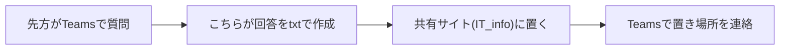
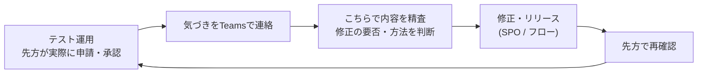

---
tags:
  - ケーテック
  - 打ち合わせ
  - アジェンダ
client: ケーテック株式会社
created: 2026-11-01
updated: 2026-11-01
---

# 2026-11-02 打ち合わせ

親: [[00 MOC|ケーテック株式会社 MOC]] ／ 前回: [[2026-10-06 打ち合わせ]]

> [!info] 開催日 2026-11-02（明日）。事前準備ノート
> 一言でいうと、**「開発（構築）フェーズが完了し、今後はテスト運用をしながら必要な部分を修正するフェーズに入る」**という報告と合意が今回の目的。
> 議題: ①前回からの実施事項の報告 → ②案件の完了状況 → ③テスト運用の進め方 → ④確認事項 → ⑤今後の予定。

## 0. 当日の進め方（目安）

| 順   | 議題        | 目的                                   | 目安  |
| --- | --------- | ------------------------------------ | --- |
| 1   | 前回からやったこと | 構築したもの（SPO・フロー・Power Query・共有サイト）を報告 | 10分 |
| 2   | 案件の完了状況   | 18件の整理と「完了」の中身を共有                    | 5分  |
| 3   | テスト運用の進め方 | **構築完了→テスト運用＋修正**への移行を合意             | 20分 |
| 4   | 確認事項・持ち帰り | 実機確認で止まっている点を解消                      | 15分 |
| 5   | 今後の予定     | 次回までの動き・連絡手段の確認                      | 5分  |

---

## 1. 前回（10/6〜7）からやったこと

### 1-1. サマリー

| # | やったこと | 状態 |
|---|---|---|
| ① | **SPOサイトの作成**（申請ポータル。最新は `s-portal_ver11.0.7`） | 完了 |
| ② | **Power Automateフローの作成**（承認フロー6本＋承認完了のTeamsチャネル通知） | 完了（実機確認は一部未了） |
| ③ | **Power Queryの作成**（SPOのリストをExcelで取得するMコード一式） | 完了（検証は一部のみ） |
| ④ | **共有サイトの作成**（Power Queryファイルなどの置き場） | 完了 |
| ⑤ | **質問対応の流れを整備**: Teamsで質問を受けたら、**txtで回答を作成して共有サイトに置く** | 運用開始 |

共有サイト: [IT_info（ドキュメント）](https://ktec19950401.sharepoint.com/sites/IT_info/Shared%20Documents/Forms/AllItems.aspx)

### 1-2. ① SPOサイト（ver11系）

前回の打ち合わせ以降、ver11.0.1〜11.0.7 まで更新。

| 版 | 主な内容 |
|---|---|
| ver11.0.1 | 休日出勤/振休/代休・夜勤の新規APP追加、権限をロールで出し分けない方針へ変更、`ApprovalMessage`（承認カードの本文）の追加 |
| ver11.0.3〜11.0.5 | 休日出勤・夜勤の入力項目整理（時刻は手入力）、慶弔の対象者を従業員台帳検索に一本化、件名の自動入力不具合の修正、年休申請を「勤怠申請」へ改名 |
| ver11.0.6 | 昼食申込に利用者氏名欄を追加（中国出張者／お客様(その他)のとき必須） |
| ver11.0.7 | 休日出勤: **代休取得日を休日出勤日の翌日以降に制限** |

詳細: [[30-プラットフォーム/spo/ver11/ver11 要望事項|ver11 要望事項]]

### 1-3. ② Power Automate（承認フロー）

> [!important] 先方に伝えるポイント
> **各申請リストに1本ずつ独立したフロー**。流れは全APP共通で、「申請 → 承認者へTeamsで承認依頼 → 承認/却下 → 結果がリストに戻る＋申請者へ通知」。
> 失敗時は却下にせず、管理者チャネルへアラート＋`Status=要手動対応`にする。

- 作成したフロー: **6本**（勤怠・仮払金・慶弔・海外保険・休日出勤・夜勤）。昼食は承認なしのため対象外
- 承認段数: **2段階承認**（1次=リーダー任意 → 2次=マネージャー必須）
- 10/16 PA ver1.0.0 で作成・開始 → 10/28 サイトをver11.0.7へ作り替えたため参照先を差し替え（ver2.0.0）
- 10/29 **承認済になったとき、申請種別ごとのTeamsチャネルへ通知を投稿**（ver2.1.0。標準チャネル・メンション無し）
- 実行テストで確認済み: **2次承認の経路**（6本とも）
- **未確認**: 1次承認・却下・要手動対応・Teamsチャネル投稿

記録: [[30-プラットフォーム/powerautomate/PA バージョン一覧|PA バージョン一覧]]

### 1-4. ③ Power Query

- 全リスト分のMコードを用意（マスタ4＋申請リスト7）
- 応用として、**昼食・勤怠・夜勤の「期間申請」を1日1行に展開するクエリ**を追加（集計しやすくするため）
- 検証状況: 実機で取得を確認したのは慶弔マスタのみ。他は未検証 → 当日の確認事項へ

記録: [[30-プラットフォーム/powerquery/Power Query MOC|Power Query MOC]]

### 1-5. ⑤ 質問対応の流れ

- 口頭・チャットで流れてしまう回答を、**ファイルとして残す**のが狙い（担当が変わっても読み返せる）
- [ ] 運用してみて**不便はないか**（置き場所・ファイル形式）を先方に確認

---

## 2. 案件の完了状況

一覧のステータス（18件のうち、動きのあるもの）。

| 課題No | 案件名 | ステータス | 補足 |
|---|---|---|---|
| 1 | 仮払金申請の自動承認フロー | **完了** | SPO＋承認フロー |
| 2 | 慶弔連絡の自動承認フロー | **完了** | SPO＋承認フロー |
| 3 | 海外保険加入依頼の自動承認フロー | **完了** | SPO＋承認フロー |
| 6 | 昼食集計表のオンライン化 | **完了** | 承認なし。月次集計はPower Queryで対応（集計表フォーマット提供待ちの点は下記） |
| 7 | 年休申請の自動承認フロー | **完了** | 「勤怠申請」として実装 |
| 13 | 承認の督促 | **完了** | 下記の確認事項 |
| 17 | 営業〜設計製作負荷管理〜支払・入金 | 未着手 | 単独プロジェクト規模。スコープ定義から |

その他: 休日出勤/振休/代休（No.19）・夜勤（No.20）は10月に新規追加し、SPO＋フローまで作成済み。

> [!warning] 当日までに確認しておくこと（こちら側）
> - **No.13（督促）が「完了」になっている**が、リポジトリ側の方針は「簡易承認方式では督促はスコープ外」。承認フロー6本に督促（リマインド）は入っていない。
>   → 「完了」の意味（スコープ外として整理済みで完了扱い？ 実装済み扱い？）を当日すり合わせる。実装するなら別途要件確認が必要。
> - 保留・取り下げ中のAPP（旅費・付与基準・Ktec Apps通知修正）は今回の一覧に出ていない。今後の扱いは § 4-3 で聞く。

---

## 3. 今後: テスト運用 ＋ 必要な部分の修正

> [!important] 今回の合意ポイント
> **構築は完了。今後はテスト運用をしながら、必要な部分を修正していく。**
> 先方に実際に使ってもらい、出てきた不便・誤りを修正する形に切り替える。

### 3-1. 運用イメージ

### 3-2. 先方と決めたいこと

- [ ] **テスト運用の期間**（いつまで／いつから本番扱いにするか）
- [ ] **テストに参加する人**（申請者役・1次承認者役・2次承認者役・総務）。未確認の経路（1次承認・却下）を一通り流せるメンバー構成にしたい
- [ ] **連絡手段と窓口**: 不具合・要望はTeamsで受ける（回答はtxt→共有サイト）。**誰が窓口か**を決める
- [ ] **要望の出し方**: 「どのAPPの・どの画面で・何をしたら・どうなったか」を書いてもらう（スクリーンショット歓迎）
- [ ] **修正の優先度と対応の流れ**: 不具合は優先、要望（機能追加）は内容を見て判断する、で良いか
- [ ] **テスト用データの扱い**: テスト運用中の申請データを本番移行時に消すか／残すか
- [ ] **本番開始の判断基準**（例: 全APPで承認〜却下〜通知まで一通り問題なし）

### 3-3. テスト運用で確認してほしいチェックリスト

| 対象 | 確認すること |
|---|---|
| 全6フロー | 1次承認（リーダー任意）あり／なしの両方で最後まで流れる |
| 全6フロー | **却下**したとき、申請者に通知が届き、`Status` が却下になる |
| 全6フロー | 承認結果（承認コメント）がリストに反映される |
| 承認済の通知 | 申請種別ごとのTeamsチャネルに投稿される（メンション無しのため、チャネルを見に行く必要あり） |
| 昼食 | 申込→取消、期間申込、前回内容の引き継ぎ |
| 休日出勤 | 代休の取得日が休日出勤日の翌日以降に制限される |
| Power Query | 総務のExcelから全件取得できる（権限の確認も兼ねる） |

---
