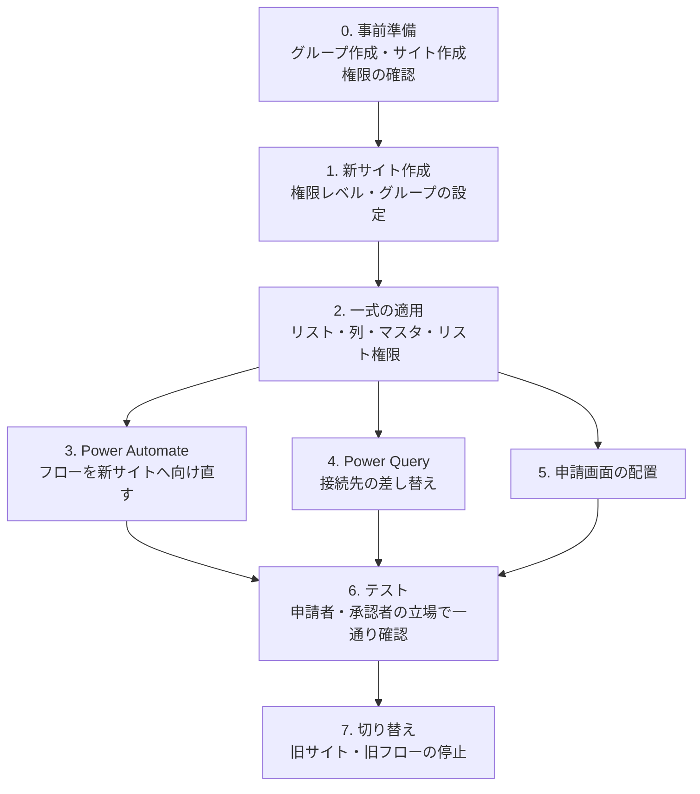

---
tags:
  - ケーテック
  - 打ち合わせ
  - アジェンダ
  - サイト作り替え
client: ケーテック株式会社
created: 2026-11-27
updated: 2026-11-27
---

# 2026-12-30 ① サイトの作り替え

親: [[2026-12-30 打ち合わせ|2026-12-30 打ち合わせ（MOC）]] ／ 次: [[2026-12-30 2 Copilot エージェント|② Copilot エージェント]]

> [!info] このノートの範囲
> 権限を最小限に絞るための**サイト作り替え**の背景・全体像・手順・先方への依頼・切り替えの進め方。
> 確認事項と宿題は [[2026-12-30 打ち合わせ|MOC]] にまとめている。

## 1. 背景と方針

### 1-1. ご要望

- 利用者には**申請に必要な機能のみ**使わせ、サイト内の不要な箇所には**極力触れられないようにしたい**。
- 承認者に、一般の利用者と別の権限設定が必要かを知りたい。

### 1-2. 権限の考え方

| 利用者 | サイトでの権限 | 申請リストでの権限 |
|---|---|---|
| 申請者（全従業員） | **閲覧者**（見るだけ。サイト内の変更はできない） | **追加と、自分が作成した申請の編集のみ**（他人の申請は変更できない） |
| 承認者 | 閲覧者 | **追加の権限は不要**（承認はメール／Teams の承認依頼で行うため）。申請の一覧を見たい場合のみ閲覧権限を付与 |
| 管理者（運用担当） | フルコントロール（現在のメンバーのまま） | 同左 |

> [!note] 「閲覧者」だけでは申請できない
> サイトの権限が「閲覧者」のままだと、申請（アイテムの追加）はできない。
> そのため、**申請リストに限り**、閲覧者より一段上の権限（追加と自分の申請の編集のみ）を付与する構成にする。

### 1-3. なぜ「サイトを作り直す」のか

- 権限を最初から組み込んだ状態で、**一式を先頭から作り直すほうが確実**（既存サイトへの後付けは、権限の取りこぼしが起きやすい）。
- 作り直しに伴い、**サイトのアドレスが変わる**ため、そのアドレスを参照している **Power Query** と **Power Automate** も新しいサイトに向け直す必要がある。
- 作り直しは、手順どおりに実施すれば**初回の構築と同じ内容を再現できる**ため、先方で今後サイトを増やす・復旧する際にも役立つ。

---

## 2. 作り替えの全体像

| 対象 | 作り替えの内容 | 規模 |
|---|---|---|
| **SharePoint サイト** | 新しいサイトを作成し、リスト・列・マスタを一式適用。権限を設定 | 大 |
| **Power Query** | 全ファイルの接続先を新サイトに差し替え。配布ファイルを入れ替え | 中（ファイル数は多いが作業は同種） |
| **Power Automate** | 承認フロー6本を新サイトの申請リストに向け直す。承認済みの通知も含めて動作を確認 | 中 |
| 申請画面（ポータル） | 新サイトへ配置し直す | 小 |
| 旧サイト・旧フロー | 切り替え後に停止（一定期間は閲覧のみで残す） | 小 |

> [!important] 今回変わらないもの
> 申請の項目・承認の流れ（1次承認→2次承認）・通知の文面は**現行のまま**。見た目と使い方は変わらず、**変わるのは権限とサイトのアドレスだけ**。

---

## 3. 手順

> [!tip] 仕組みの詳細
> 以下の手順の裏側（XML・スクリプト・申請画面・環境変数・Power Query がどう繋がっているか）は
> [[リポジトリ構成とデプロイの仕組み(XML・SPFx・フロー・Power Query)#10. 12/30 のサイト作り替えにあてはめる|リポジトリ構成とデプロイの仕組み § 10]] を参照。

### 手順0　事前準備

| # | 作業 | 担当 |
|---|---|---|
| 0-1 | 次の3つのグループを用意する（M365 グループまたはセキュリティグループ）: **①申請者（全従業員）／②承認者／③管理者（運用担当。現在のメンバーのままで可）** | 先方 |
| 0-2 | グループ名と、可能であれば**オブジェクトID**（Entra 管理センターのグループ詳細に表示）を共有 | 先方 |
| 0-3 | 新サイトを作成できるアカウントと、サイト作成の許可を確認 | 双方 |
| 0-4 | 旧サイトの申請データの扱い（引き継ぐか／閲覧のみで残すか）を決める | 双方 |
| 0-5 | マスタ（従業員・慶弔・メニュー・営業日カレンダー）の最新データを用意 | 先方 |

### 手順1　新サイトの作成と権限の土台

| # | 作業 | 確認 |
|---|---|---|
| 1-1 | 新しいサイトを作成する（サイト名・アドレスは先方と合意したもの） | アドレスを控える |
| 1-2 | 「追加と自分の申請の編集のみ」の**権限レベル**を新しく作る（標準の「投稿者」は他人の申請も編集・削除できてしまうため使わない） | サイト権限の設定画面に表示される |
| 1-3 | サイトに**申請者グループを「閲覧者」**として追加する | 一般利用者のアカウントでサイトを開き、変更操作ができない |
| 1-4 | 管理者グループにフルコントロールを付与する | 管理者のアカウントで設定画面に入れる |

### 手順2　リスト・列・マスタの適用と、リストの権限

| # | 作業 | 確認 |
|---|---|---|
| 2-1 | 申請リスト・マスタ・共通の列とコンテンツタイプを、あらかじめ用意した定義どおりに**一括で適用**する | 全リストが作成され、列・選択肢が現行サイトと一致する |
| 2-2 | マスタのデータ（従業員・慶弔・メニュー・営業日カレンダー）を投入する | 件数が元データと一致する |
| 2-3 | 各申請リストの**権限の継承を停止**し、申請者グループへ手順1-2の権限を付与する | 一般利用者のアカウントで、申請の追加ができ、他人の申請は変更できない |
| 2-4 | リストの詳細設定「アイテムごとのアクセス許可」を設定する（読み取り／編集とも「自分が作成したアイテムのみ」） | 他人の申請が一覧に出ない |
| 2-5 | 承認者グループに対象リストの閲覧権限を付与する（一覧を見せる場合のみ） | 承認者のアカウントで一覧が見える |

> [!warning] 注意点
> - 継承を停止するリストは、**グループの指定漏れがあると申請者以外が一覧を取得できず、エラーになる**。全リストで「一般利用者」「承認者」「管理者」の3つの立場で必ず確認する。
> - 申請者が自分の申請を見られない設定にしないこと（「自分が作成したもの」は見える設定にする）。

### 手順3　Power Automate（承認フロー6本）

| # | 作業 | 確認 |
|---|---|---|
| 3-1 | 承認フロー（6本）を、新サイトを参照する形で用意する。フローはサイトのアドレスと各リストのIDを**設定値（環境変数）**として持っているため、フロー本体の作り直しではなく、**設定値を新サイトのものに差し替える** | 6本とも、サイトアドレス・リストIDが新サイトのものになっている |
| 3-2 | 設定値の差し替え対象: サイトのアドレス（1つ）／各申請リストのID（6つ）／管理者通知の宛先（1つ）。リストIDは新サイトの適用後に確定する | 設定値の一覧と新サイトのリストが対応している |
| 3-3 | **新サイトの動作確認が済むまで、新フローは停止の状態**にしておく（移行データなどで承認依頼が飛ぶのを防ぐため） | — |
| 3-4 | 承認の宛先が、申請者が選んだ「承認者」の列になっていることを確認する | 宛先がその列を参照している |
| 3-5 | 失敗時の動作を確認する（却下にせず、管理者へ通知＋「要手動対応」にする） | テストで再現できる |
| 3-6 | 動作確認ができたらフローを有効にする。**旧サイトを参照している旧フローは、承認中の申請がないことを確認してから停止** | 旧フローに実行待ちがない |

### 手順4　Power Query

| # | 作業 | 確認 |
|---|---|---|
| 4-1 | 全クエリ（マスタ／各申請リスト／日別に展開する応用クエリ／昼食の締め期間の抽出）の**サイトのアドレスを新サイトのものに差し替える** | 旧サイトのアドレスが全ファイルから消えている（検索して確認） |
| 4-2 | 共有サイト（IT_info）に置いている配布用ファイルを、差し替え後のものに入れ替える | 旧ファイルは「旧」と分かる形で別の場所へ移す |
| 4-3 | 先方の Excel で使っているクエリを、新しい内容に入れ替える（接続先の変更） | 全クエリで取得でき、件数が新サイトと一致する |
| 4-4 | 総務の担当者のアカウントで、**一覧を取得できる権限があること**を確認する（手順2-3の権限設定の影響を受けるため） | 取得エラーが出ない |

> [!warning] 権限と Power Query の関係
> 「自分が作成した申請のみ見える」設定にすると、**一般の利用者が Excel から取得しても自分の分しか出ない**。全件を集計する担当者（総務など）には、対象リストの閲覧権限を持つグループへ入ってもらう必要がある。

### 手順5　申請画面（ポータル）の配置

| # | 作業 | 確認 |
|---|---|---|
| 5-1 | 申請画面を新サイトへ配置する | 申請者のアカウントで、各申請の画面が開く |
| 5-2 | 申請者が「承認者」を選べる／申請後に承認者を変更できない | 画面で確認 |

### 手順6　テスト（申請者・承認者・管理者の3つの立場）

| 立場 | 確認すること |
|---|---|
| 申請者 | 各申請を1件ずつ提出できる／自分の申請だけが見える／他人の申請は変更できない／サイト内の他の場所は変更できない |
| 承認者 | 承認依頼が届く／承認・却下ができる／結果と承認コメントがリストに反映される／承認済みのとき、申請の種類ごとの Teams チャネルに通知が出る |
| 管理者 | 全リストの全件を確認できる／失敗時の管理者通知が届く |
| 総務 | Power Query で全件取得できる |

### 手順7　切り替え

| # | 作業 |
|---|---|
| 7-1 | 切り替え日を決め、利用者へ新しいアドレスを案内する |
| 7-2 | 旧サイトの申請画面を止め、旧サイトを**閲覧のみ**にして一定期間残す（戻す場合に備える） |
| 7-3 | 旧サイトを参照する旧フローを停止する（承認中の申請が残っていないことを確認してから） |
| 7-4 | 一定期間後、旧サイトを削除するか保管するかを判断する |

---

## 4. 先方にお願いすること

- [ ] **グループの作成**: 申請者（全従業員）／承認者／管理者。既存の全社用グループがあれば流用可
- [ ] **グループ名の共有**（可能であれば**オブジェクトID**も。Entra 管理センターのグループ詳細に表示）
- [ ] グループの**種類**（M365 グループかセキュリティグループか）
- [ ] 新サイトを作成するアカウントの確認（サイト作成が制限されていないか）
- [ ] マスタ（従業員・慶弔・メニュー・営業日カレンダー）の最新データ
- [ ] **グループのメンバー管理**（入社・退社・異動に伴う出し入れ）の担当を決める
- [ ] 切り替え日の候補、テストに参加する人

---

## 5. 切り替えの進め方（決めたいこと）

- [ ] **旧サイトの申請データ**: 新サイトへ引き継ぐか、旧サイトを閲覧のみで残すか（後者が安全）
- [ ] **承認中の申請**: 旧サイトの旧フローで完了させる（推奨）か、新サイトで再申請にするか
- [ ] **切り替えの時間帯**: 申請を止める時間を設けるか
- [ ] **ID（申請番号の代わりに使っているもの）**: 新サイトでは採番し直しになる。旧IDを参照する運用はあるか
- [ ] **スケジュール**（仮置き）: 年末年始をまたぐため、**テスト〜切り替えを1月以降にするか**を相談
