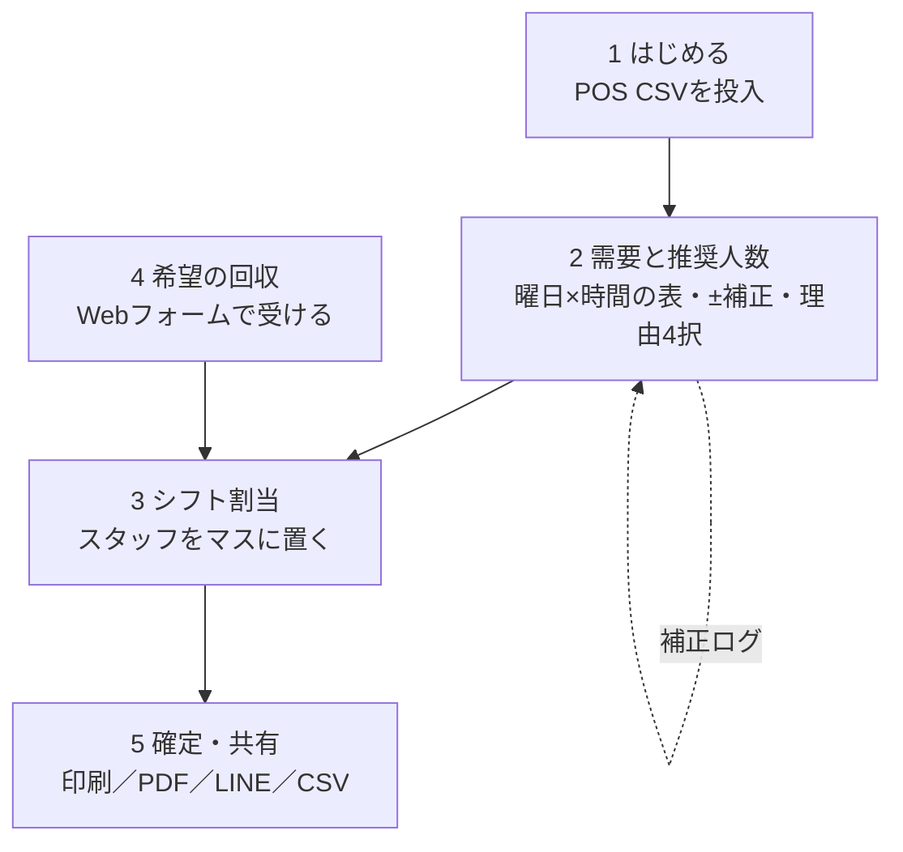

---
tags:
  - shift-app
  - mvp
  - requirements
project: シフト管理APP
status: 叩き台
created: 2026-11-28
updated: 2026-11-28
---

# 02 MVPの範囲

親: [[00 MOC]] ／ 差別化との対応: [[01 差別化と勝ち筋]]

> [!note] 状態
> 市場調査資料の提案で、seon ch の承認はまだ。確定したら [[00 MOC]] の決定ログに移す。

## 全体の流れ

## 画面5つ

| # | 画面 | 中身 | 担う差別化 | 画面案 |
|---|---|---|---|---|
| 1 | はじめる（CSV投入） | POS CSV をドロップ → 列を対応づけ → **その場で推奨表が出る** | ③と①の初回体験 | **未作成** |
| 2 | 需要と推奨人数（週表示） | 曜日×時間のマスに「決済18件 → 推奨3人／配置2人」、根拠の式を1行、±ボタンと理由4択 | ①と②の心臓部 | 作成済（01・02） |
| 3 | シフト割当 | スタッフをマスに置く。不足＝赤／過剰＝青。週の概算人件費を横に出す | 「あと何人必要か」が組む場所で分かる | 作成済（03）。差分あり |
| 4 | 希望の回収 | 希望休・シフト希望を Web フォーム／LINE で受ける（スタッフはアプリ不要） | 店長の一番の手間を消す | **未作成** |
| 5 | 確定・共有 | 印刷／PDF／LINE／CSV で配る | Excel に戻らず完結する | 03 の下部ボタンのみ |

## 必須機能8つと受入条件

| # | 機能 | 受入条件（できたと言える線） |
|---|---|---|
| 1 | スタッフ登録 | 名前・時給・入れる時間帯・雇用区分を登録でき、**20人を10分で**入れられる |
| 2 | POS CSV 取り込み | 日時・決済件数・点数（あれば）を読み、列の対応づけを画面で直せる。**主要POS 3種のテンプレで手作業ゼロ** |
| 3 | 曜日×時間の推奨人数表 | 7日×営業時間のマスに推奨人数が出て、各マスに式と使用値を表示 |
| 4 | ±補正と理由タップ | マスの±で1人単位に直せ、理由4択を1タップで記録。**記録は即時保存** |
| 5 | シフト割当 | スタッフをマスに置け、推奨との過不足が色で分かる |
| 6 | 概算人件費 | 時給×時間で週合計と日別が出る（残業・深夜割増は v2） |
| 7 | 希望休・希望の回収 | Web フォームまたは LINE で受け、回答がカレンダーに反映される |
| 8 | 出力・共有 | 印刷／PDF／LINE／CSV で週のシフトを配れる。スマホで読める |

## 入力データは3つだけ

**POS CSV・営業時間・スタッフ**。これで初日から自店データの表が出る（差別化③）。データの持ち方は [[03 推奨人数の計算式]]。

## v2以降（今は作らない）

打刻・勤怠、給与計算・連携、多店舗の横断分析、スポットワーク（タイミー等）への欠員募集、多言語、年収の壁・週28時間アラート、需要予測AI（天気・イベント・セールの上乗せ）、POS API の自動連携。

## やらないこと

POS機能そのもの、会計・在庫、評価・教育、独自の給与振込、勤怠の法対応（36協定・変形労働の判定）。

## 未決との関係

- 希望回収を LINE にするか Web フォームのみにするか → [[_未確定事項]] A-3（推奨: Web フォームのみ）。機能7の「または LINE」は、この判断で外れる。
- 対象業種（小売先行か飲食も含めるか）→ A-2。
