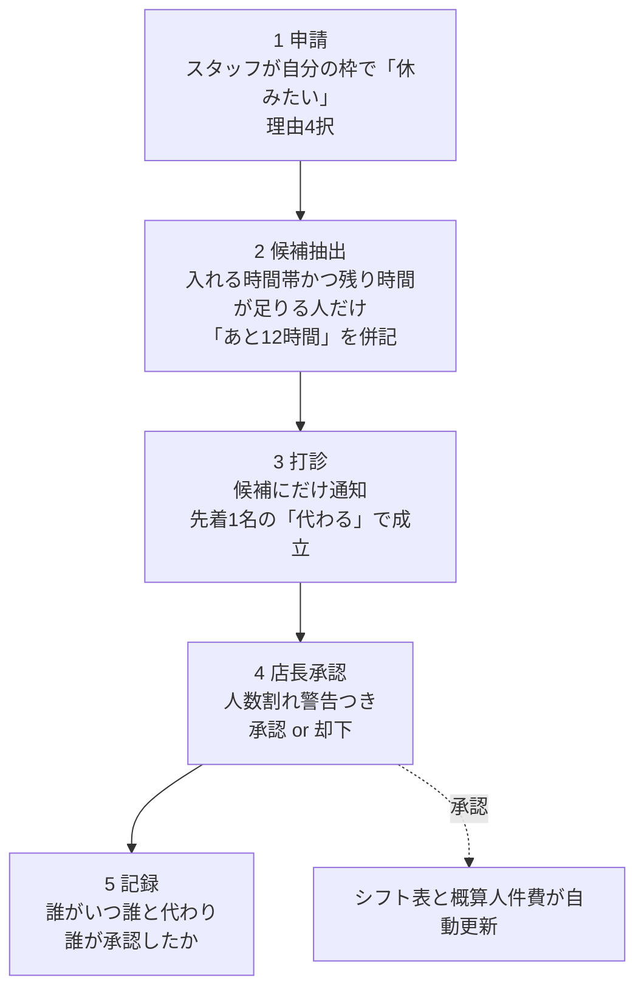

---
tags:
  - shift-app
  - spec
  - swap
project: シフト管理APP
status: MVPに採用（細部は仮）
created: 2026-11-28
updated: 2026-11-28
---

# 06 入れ替え（交代）機能

親: [[00 MOC]] ／ 数字の土台: [[07 稼働時間と人件費・予算]] ／ 範囲への組み込み: [[02 MVPの範囲]]

> [!note] 状態
> 2026-11-28 に seon ch から追加の希望。**MVP に入れる**と決めた（[[00 MOC]] 決定ログ）。資料に無かった細部は 〔仮〕 で補い、[[_未確定事項]] C-7・C-10・C-11 に残している。

## 目的

**急な欠員を、スタッフ同士の交渉で埋め、店長は最終承認だけを行う。** 入れたい理由は3つ。

1. 急な欠員は現場でいちばんストレスな作業。アプリで解決できないと結局 LINE で個別にやり取りになり、**毎週開く理由が消える**。
2. シフト単体ツールは解約率が高い。**「毎週使う理由」をここで作る**（[[05 リスクと対策]] の最大リスク「解約」への対策）。
3. 承認時に「この交代で推奨人数を割るか」を判定できる。**ただの交代掲示板ではなく、レジ実績の推奨人数と繋がる機能になる**（[[01 差別化と勝ち筋]] ①）。

## 前提：稼働時間の2本

| 項目 | 意味 | 例 |
|---|---|---|
| 上限 | これ以上は入れない | 扶養の壁／週20時間／留学生28時間／本人の都合 |
| 希望 | 最低これだけは入りたい | — |

**残り時間 ＝ 上限 − 確定シフト時間。** 金額（時給×時間）はこの計算の副産物として横に置く。**中心は時間。** → [[07 稼働時間と人件費・予算]]

## フロー

1. **申請:** スタッフが自分のシフト枠で「休みたい」を押す。理由は4択（体調／私用／学校／その他）、**自由記入なし**。
2. **候補抽出:** 「その時間帯に入れる」かつ「残り時間が足りる」人だけ。各候補に「あと12時間」を併記。
3. **打診:** 候補**にだけ**通知（全員に流さない）。先着1名の「代わる」で成立。辞退も可。
4. **店長承認:** 承認画面に人数割れ警告（例「この交代で14時が2人になります／推奨3人」）。承認または却下。
5. **記録:** 誰がいつ誰と代わり、誰が承認したかを履歴に残す（CSV出力可）。

## 業務ルール

- **店長の承認なしでは確定しない**（勝手に変わらない）。
- **推奨人数を下回っても承認は可能。** 警告を出すだけで止めない。
- 申請の**締切を店舗設定**で持つ。既定は**シフト開始24時間前まで**。締切を過ぎた申請は受け付けない（店長が直接直す）。
- 上限が未設定のスタッフは「未設定」表示にし、**候補からは外さない**（警告のみ）。
- 同じ枠に複数の申請が来たら1件にまとめる。

## データ

| レコード | 項目 |
|---|---|
| 交代申請 | id／対象シフト枠／申請者／理由／状態（申請中・成立待ち・承認待ち・確定・却下・取消）／作成日時 |
| 打診 | 申請id／候補者／応答（承諾・辞退・未回答）／応答日時 |
| 承認 | 申請id／店長／判定／任意コメント／日時 |
| 監査ログ | 上記すべてを保持し、CSV で出力できる |

### 状態の定義〔仮〕

資料に定義がないので、次のように置いた。

| 状態 | 意味 | 次へ進む条件 |
|---|---|---|
| 申請中 | スタッフが申請した。候補を抽出して打診を送る段階 | 打診を送信 |
| 成立待ち | 候補に打診中。誰も「代わる」を押していない | 先着1名が「代わる」→ 承認待ち／全員辞退・締切 → 取消 |
| 承認待ち | 「代わる」が押され、店長の判断を待つ | 承認 → 確定／却下 → 却下 |
| 確定 | 店長が承認。シフト表と人件費に反映済み | — |
| 却下 | 店長が却下。元のシフトのまま | — |
| 取消 | 申請者が取り下げた、または候補0人・全員辞退・締切超過 | — |

- **候補が0人**のとき: 店長に「代わりが見つかりません」と通知する（店長が直接手配）。
- 同じ枠への複数申請は1件にまとめる（業務ルールどおり）。

### スタッフ側の入り口〔仮〕

- スタッフには**本人専用リンク**を渡す（ログインやアプリのインストールは不要）。申請・打診への応答・自分のシフトと残り時間の確認は、このリンクの画面で行う。
- 打診の通知は、リンクつきの**メール（またはSMS）**で届ける。LINE 公式アカウントは A-3 の方針どおり後から追加（要望3店以上）。
- スタッフには自分の残り時間だけを見せ、予算額・平均時給・他人の時給は見せない（[[07 稼働時間と人件費・予算]]）。

## 受入条件

- スタッフが **3タップ以内**で休み申請できる。
- 候補に残り時間が出て、入れない人は候補に出ない。
- 店長の承認画面で人数割れが分かる。
- 承認後、**シフト表と概算人件費が自動で更新**される。
- 履歴が残り、CSV で出せる。

## 今回入れないもの

スポットワーク（タイミー等）への募集、複数枠の一括交代、給与への反映。

## MVP に入れる理由と、そのコスト

- **入れる理由:** 解約が最大リスク（[[05 リスクと対策]]）。「毎週開く理由」を作るのがこの機能の役割。
- **コスト:** スタッフ側の画面（本人リンク）と通知が増える。「スタッフはアプリ不要」は保ち、**ログインなし・本人リンクのみ**で収める。
- **差別化③との関係:** 「機能を足さないこと」は設定の軽さの話。交代は**設定項目を増やさない**（上限・希望の2つと締切のみ）ので、初日の表（CSV・営業時間・スタッフ）は変わらない。→ [[01 差別化と勝ち筋]]
