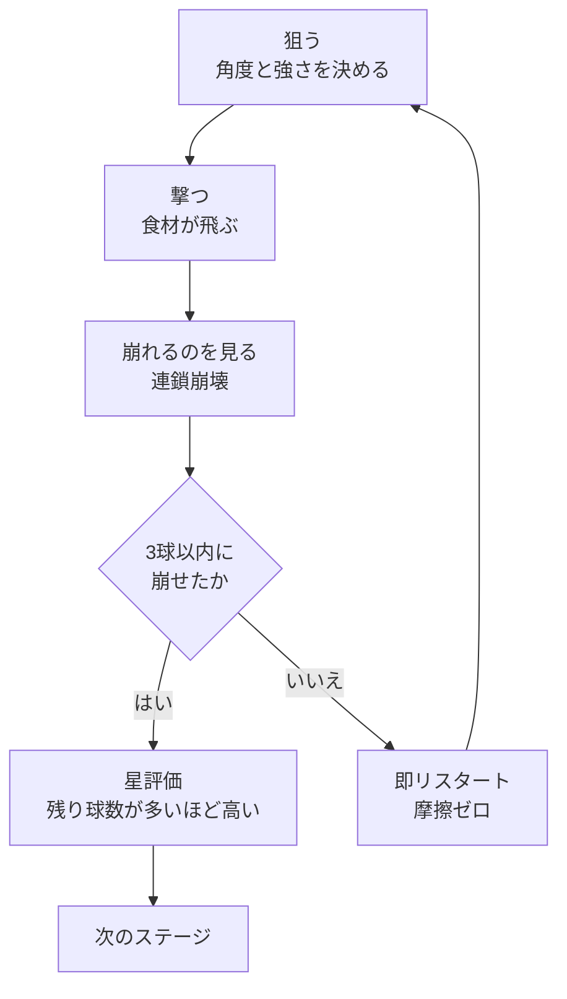

---
tags:
  - game
  - planning
---

# 面白ポイントとコアループ

親: [[料理大砲 - 00 概要|概要]]

## コアループ

## 面白ポイント

| # | 面白さ | なぜ楽しいか | どう確かめるか |
|---|---|---|---|
| 1 | 「どこを撃つか」を考える | 因果を読んで1手を選ぶビリヤード的な思考。予測軌道線は1バウンドまでに留め、見せすぎない。ただし子供向けに、**着地点の目印**を足す〔仮〕 | 紙プロトで、初見の人が「考え込む」か |
| 2 | 連鎖崩壊の爽快感 | 演出ではなく連鎖そのものから生む（ドミノ・シーソー・くさびの組み合わせ） | グレーボックスで、崩れる様子だけで気持ちよいか |
| 3 | 二層構造 | 知識ゼロでも3球総当たりで解ける。知れば1球の裏ワザがある | 総当たりで解けるか／裏ワザを見つけた人が喜ぶか |

## ルール

- 1ステージ＝3球まで。残り球数が星評価（3球使用＝1星、1球＝3星）。
- 崩壊途中の撃ち直しは不可。手番ごとに必ずリセットされ、失敗したら即リスタート。
- 1球目＝きっかけ／2球目＝修正／3球目＝トドメ、が基本構造。1球で終わるのはチュートリアルのみ。
- 成功は、**塔のてっぺんの目印（さくらんぼなど）を落とすこと**。内部判定は、目印の落下と**傾き角度が閾値を超えた瞬間**を併用する〔仮〕。

## 食材＝パズルの語彙（形×素材の掛け算）

| 食材 | 物理特性 | 役割 |
|---|---|---|
| スイカ | 重い・転がる | 遠くへ運ぶ、押し潰す |
| 卵 | 極めて脆い | 割れるスイッチ |
| 豆腐 | 軽くて軟らかい | クッション・土台 |
| バター/氷 | 摩擦ゼロ | 滑り台 |
| 餅/チーズ | 粘着 | 巻き込んで引きずり落とす |
| プリン/ゼリー | 高反発 | バウンドの仕上げ |
| かぼちゃ/鉄鍋 | 超重い | シーソーの錘 |

## 操作（子供向け）〔仮〕

- 指は細かく動かせない前提。**画面を大きくドラッグ**して狙い、離して撃つ。
- 角度は**段階にスナップ**させる（細かい誤差を丸める）。
- 強さは「弱・中・強」の**3段階**。
- **両手を使う**：画面の**左側**で、片手の親指でドラッグして狙う。**右側**に大きな強さボタン3つ（弱・中・強）と**撃つボタン**を置き、もう片手で選んで押す。
- 撃つのは専用ボタン。狙って、確かめて、撃つ流れにして、誤射を減らす。
- 落ちる場所が分かるガイド：1バウンドまでの予測軌道線に加えて、**着地点の目印**を出す。
- 「考える」要素は「どこを撃つか」「どの食材を使うか」に置き、**操作の精度は問わない**。
- 文字は使わず、アイコンと動きで説明する。
- 大人は**ヒントを出す**（「卵はどこに当てると割れるかな？」と会話で）。**アプリ内のヒントボタンは作らない**（大人が会話で出す）。

## ステージ設計の考え方

- ブロックの形は「単語」、ステージは「文章」。ドミノ（棒）・斜面（くさび）・シーソー（T字）を組み合わせる。
- ゴールの崩壊シーンから逆算して設計する。
- 物理は非決定的なので、「多少ブレても解ける」余白で設計する。

## 気持ちよさの要素

- 着地で画面スクワッシュ、トドメの一撃に0.3倍速スロー0.5秒。**興奮してOK**。爽快感を優先して作る。
