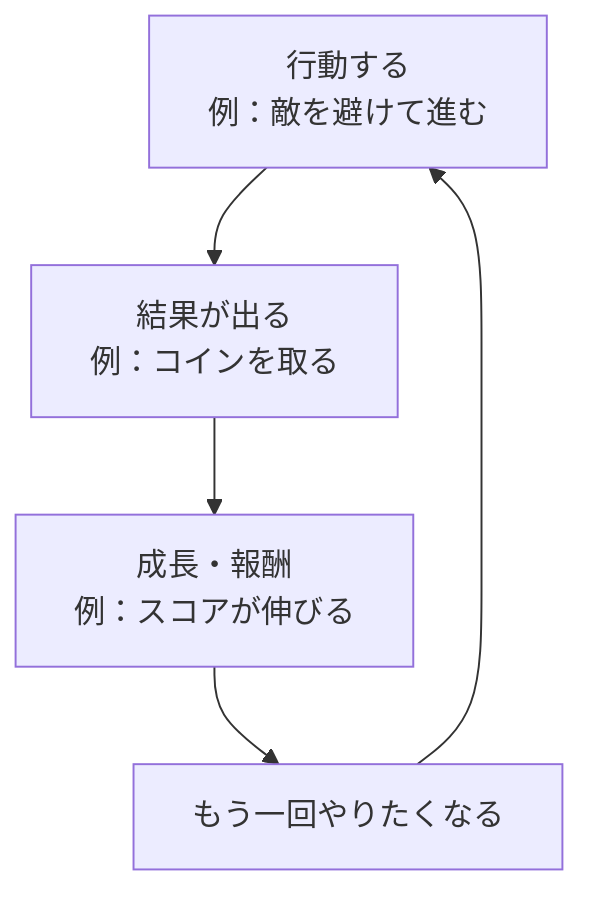

---
tags:
  - game
  - planning
---

# 面白ポイントとコアループ

親: [[ゲーム名 - 00 概要|概要]]

## コアループ

プレイヤーが何度も繰り返す10秒〜1分の行動。ここが面白くなければ、他を作り込んでも面白くならない。

## 面白ポイント（3つまで）

| # | 面白さ | なぜ楽しいか | どう確かめるか |
|---|---|---|---|
| 1 |  |  |  |

## 他のゲームとの違い

- 

## 気持ちよさの要素（任意）

操作の手触り・音・演出・成長実感・ギリギリ感など。
